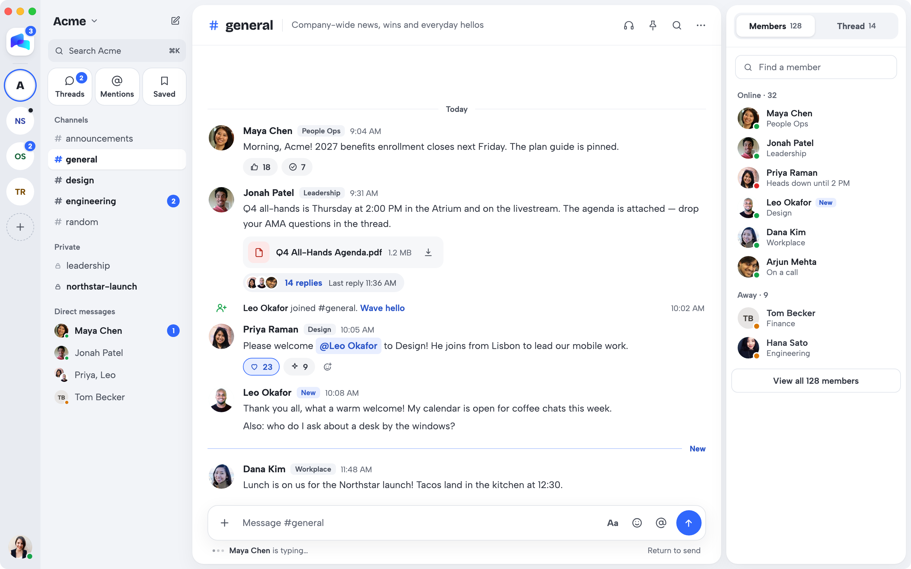

# Lumia

Lumia is a chat app you can host yourself. Servers with public and private channels, direct messages inside and outside servers, threads, reactions, and calls, in the shape you know from Discord and Slack. The difference is who runs it: anyone can host an instance, an instance can hold many servers, and one client connects to as many instances as you like, as one flat list of servers.

Personal DMs are end-to-end encrypted. Server content is readable by the people who run the server, and the app tells you which is which.

<p align="center">
  <picture>
    <source media="(prefers-color-scheme: dark)" srcset="docs/screenshots/desktop-dark.png">
    
  </picture>
</p>

<p align="center"><sub>The design the apps are drawn to, with made-up people in it. It runs ahead of the apps: see Status.</sub></p>

## Status

Early, and used by a handful of testers. The instance, the client core and the apps run: signing in, servers and channels, invites, presence, end-to-end encrypted personal DMs, devices and push notifications. Install below says where each app comes from; the Windows and Linux builds are previews that nobody has tried on those systems yet.

Not built yet: threads, reactions, attachments, search and calls, all of which the pictures above show. [docs/plan.md](docs/plan.md) says what is done and what is next.

## Install

Every app starts by asking which instance to sign in to. **`my.lumia.chat`** is the flagship, the instance Lumia runs for everyone, and anyone can make an account there; any other instance is its address, whether someone else runs it or you host it yourself, and one app can be signed in to several. The downloads are on the [latest release](https://github.com/lumia-chat/lumia/releases/latest).

### macOS

macOS 14 or later, on Apple silicon or Intel. Download `Lumia-<version>.dmg`, open it and drag Lumia to Applications. The app is signed and notarized, and updates itself: it checks once a day, and **Lumia › Check for updates…** checks now.

### Windows (preview)

Windows on x86-64. Download `Lumia-<version>-windows-x86_64-preview.zip`, unpack it anywhere and open `Lumia.exe`. It is not signed yet, so SmartScreen warns the first time: choose **More info**, then **Run anyway**. There is no installer and no updater, so a new version is a new download. Signing in through the browser (a passkey, or an organization's sign-in) cannot come back to the app yet: sign in with a password, or link the computer from another device.

### Linux (preview)

On Debian or Ubuntu, install the package from [packages.lumia.chat](https://packages.lumia.chat), which adds the repository so Lumia updates with the rest of the system:

```sh
# Intel or AMD (x86-64)
curl -fLO https://packages.lumia.chat/apt/pool/main/lumia_<version>_amd64.deb
sudo apt install ./lumia_<version>_amd64.deb

# Arm (arm64)
curl -fLO https://packages.lumia.chat/apt/pool/main/lumia_<version>_arm64.deb
sudo apt install ./lumia_<version>_arm64.deb
```

On Fedora and other dnf systems:

```sh
# Intel or AMD (x86-64)
sudo dnf install https://packages.lumia.chat/rpm/x86_64/lumia-<version>-1.x86_64.rpm

# Arm (aarch64)
sudo dnf install https://packages.lumia.chat/rpm/aarch64/lumia-<version>-1.aarch64.rpm
```

Anywhere else, download `Lumia-linux-x86_64-preview.AppImage` or `Lumia-linux-aarch64-preview.AppImage`, make it executable (`chmod +x`) and open it; it needs FUSE, which most desktops have. It updates itself: Preferences has the choices, and nothing is downloaded until you choose Update. Every build needs a Vulkan driver.

### Android

Android 9 or later. Download `Lumia-<version>.apk` on the phone and open it, allowing the browser to install apps when Android asks. To get new versions as they are released, add `https://github.com/lumia-chat/lumia` to [Obtainium](https://github.com/ImranR98/Obtainium). Every release is signed with the same key, so each one installs over the last.

### iOS

iOS 17 or later. While Lumia is in testing it is on TestFlight, by invitation; there is no App Store listing yet.

### Web

There is nothing to install. Every instance serves the web app at its own address: open [my.lumia.chat](https://my.lumia.chat) in a current browser for the flagship, or your instance's address for any other, and sign in.

### Hosting an instance

An instance is two containers, the Lumia image and Postgres. [apps/instance/README.md](apps/instance/README.md) has the commands and [docs/specs/deployment.md](docs/specs/deployment.md) the contract.

## How it works

- **Instances are islands.** Each one is a deployment: an Elixir server, a Postgres database, and a blob store. Instances never talk to each other. The client bridges them.
- **One identity, many accounts.** Your identity is a key hierarchy on your devices. Each instance you use holds an account bound to it. Joining a server on a new instance is a URL and a tap.
- **Two kinds of DM.** Server DMs belong to the server and follow its rules. Personal DMs belong to the people in them and are encrypted with MLS so no server, including ours, can read them.
- **One core, native shells.** macOS, Windows, Linux, iOS, Android and the browser share one Rust client core; each platform gets a native shell around it.
- **Self-hosting is two containers.** The Lumia image and Postgres. Everything else is optional.
- **Open by design.** The server is AGPL-3.0 with no enterprise edition. The client core and protocol schemas are Apache-2.0. Bots, agents, and third-party clients use the same public API the official apps do, and every instance speaks MCP.

## Documents

| Document | What it covers |
|---|---|
| [docs/architecture.md](docs/architecture.md) | Every architectural decision, the alternatives rejected, and why. The hard rules in section 1 govern everything else. Start here. |
| [docs/protocol.md](docs/protocol.md) | The wire contract: encodings, the gateway, sequence numbers, idempotency, the HTTP mapping, errors, authentication, identity proof. |
| [docs/specs/](docs/specs/) | Implementation specs for identity, delivery, and authorization, each with its failure-injection tests. |
| [docs/plan.md](docs/plan.md) | The task checklist with status, and the decisions that changed along the way. |
| [proto/lumia/v1/](proto/lumia/v1/) | Protobuf schemas. The single source of truth for every shape on the wire; all client and server types are generated from them. |

## Repository layout

```
apps/instance   Elixir (Phoenix); what one deployment runs
apps/core       Rust client core: protocol, sync engine, local store, identity; lumia-cli
apps/apple      SwiftUI: the iOS app
apps/android    Jetpack Compose
apps/desktop    The desktop shell for macOS, Windows and Linux, in Rust on Rune
apps/relay      Push relay for APNs and FCM
apps/web        Web UI (SolidJS) for the browser
assets/         Logo, icons, fonts and design tokens shared by every shell
proto/          Protobuf schemas
docs/           Architecture, protocol contract, and specs
spikes/         Throwaway code behind the write-ups in docs/spikes
```

Section 18 of the architecture doc gives the order these were built in, and section 21 says what each directory holds.

## Contributing

Read [docs/architecture.md](docs/architecture.md) first. A change that conflicts with it needs to amend the document before it changes code. The protocol schemas only ever gain fields; see [docs/protocol.md](docs/protocol.md) section 3.

## License

Copyright (C) 2026 Ryan Winchester.

Server: AGPL-3.0. Client core and protocol schemas: Apache-2.0.

The root [LICENSE](LICENSE) is AGPL-3.0 and applies to everything not covered by a more specific license file. `apps/instance` carries its own copy of AGPL-3.0 because it ships as a container image. `proto/` and `apps/core` carry Apache-2.0. The Lumia name, logo and wordmark in `assets/brand` are not open source: they are the brand, all rights reserved, with the permitted uses in [assets/brand/LICENSE](assets/brand/LICENSE); a fork replaces them. The fonts in `assets/fonts` are SIL OFL.
