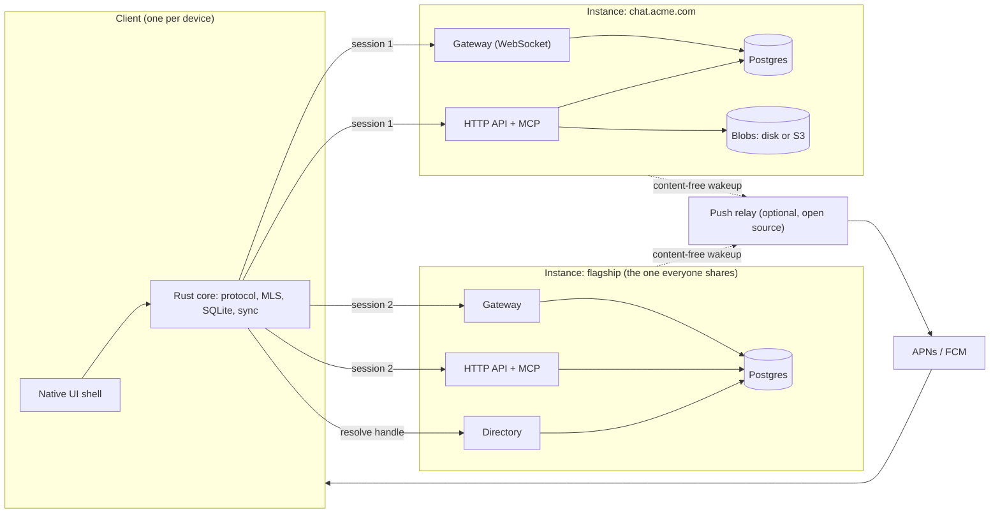
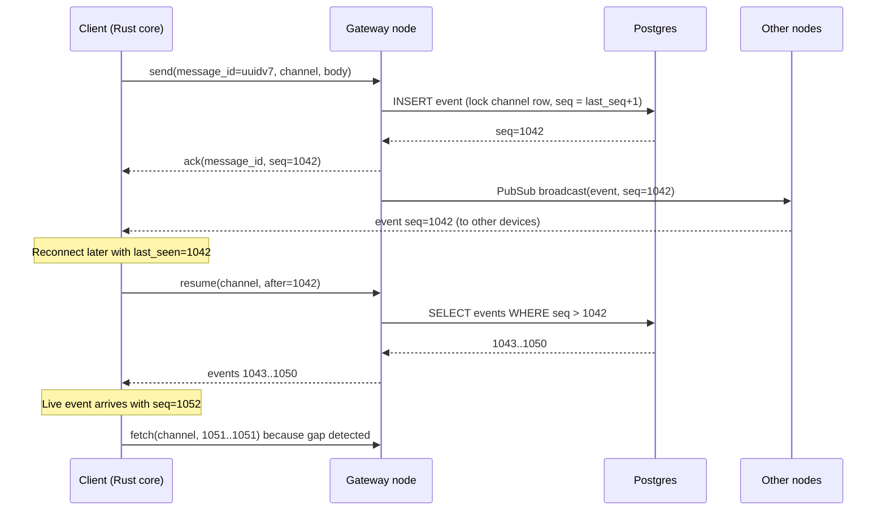

# Lumia Architecture

Status: accepted, 2026-11-01. This is the source of truth for architectural decisions. Each section records a decision, the alternatives rejected, and why. Change it by editing the decision and its rationale, not by appending exceptions elsewhere.

Lumia is a chat app: servers with public and private channels, direct messages inside and outside servers. The difference from Discord and Slack is that anyone can self-host an instance, an instance can hold many servers, and one client talks to many instances at once.

## 1. Principles and hard rules

Priorities, in order: performance, privacy, security. When they conflict with convenience, they win.

Hard rules. Any future decision that violates one of these must amend this section first.

1. **Instances are islands.** No server-to-server traffic in v1. The client does all cross-instance bridging.
2. **Self-hosting is two containers.** The Lumia image and Postgres. No Redis, no search engine, no message broker. Everything optional (push relay, TURN, SFU, S3) must have a working default without it.
3. **No unconfigured outbound calls.** The server makes no network request the operator did not explicitly configure. The push relay is the only Lumia-operated dependency and it is optional.
4. **First-party clients use only the public API.** There are no private endpoints. If a first-party client needs something, the public API gains it.
5. **Scope determines governance.** Server content (channels, server DMs) is readable by the server, its admins, and its bots. Personal DMs are end-to-end encrypted and no server can read them. A conversation has exactly one of these two natures and it never changes.
6. **One edition.** There is no enterprise edition and no feature a self-hoster cannot run. Every feature ships in the AGPL server. Hosted plans sell capacity and convenience, never code.

## 2. System overview



An **instance** is one deployment: one Postgres database, one or more homogeneous Elixir nodes, one blob store. An instance hosts many **servers**. A server has channels, roles, members, and server DMs. Users hold **accounts** on instances, each bound to one **identity**, which is a keypair held on their devices. The **flagship** is the instance Lumia operates. It runs the same code as every other instance with no special cases, and additionally runs a **directory**.

A client holds one session per instance it is connected to. The user sees one flat list of servers; the instance is plumbing that surfaces only where trust or routing depends on it (section 5).

## 3. Server runtime and clustering

**Decision.** A single Phoenix application (contexts, not an umbrella) released as one OCI image. Nodes are homogeneous and stateless apart from connection processes and presence. Postgres is the single source of truth. Nodes discover each other with libcluster and fan out events over Phoenix.PubSub using the `pg` adapter. Presence uses Phoenix.Presence CRDTs. Hot caches are per node and invalidated by PubSub messages. Rust is used through Rustler NIFs only where Elixir is measurably the wrong tool: MLS delivery-service operations, image decoding and EXIF stripping, BLAKE3 hashing, and any future hot-path codec.

**Rejected.**
- *A process per channel or server pinned to one node (Horde, `:global`).* Gives in-memory serialization and hot state but brings handoff on node loss, split-brain on partition, and a cluster-coordination story a single-node self-hoster has to carry anyway. Postgres already serializes writes per channel (section 6).
- *No Erlang distribution, coordinate through Postgres LISTEN/NOTIFY.* Simpler ops but puts every real-time fan-out through the database, which is the one component that does not scale horizontally here.
- *Redis for PubSub, presence, or rate limits.* Violates hard rule 2.

**Rationale.** Statelessness makes single-node trivially correct and multi-node a configuration change. Erlang distribution is the cheapest reliable fan-out available to an Elixir deployment and costs the operator nothing.

**Consequences.** Rate limiting is per node for cheap operations (section 8). Any state that must be exactly-once lives in Postgres, not in a process.

## 4. Identity and accounts

### 4.1 Identity is a keypair

**Decision.** Every user has an **identity key**: an Ed25519 keypair generated in the client's Rust core. It is the root of trust for end-to-end encryption and the thing that makes "you on Acme's instance" and "you on the flagship" the same person. An **account** on an instance is bound to exactly one identity by proof of key ownership at signup, or later by linking. An identity carries a **signed profile** (display name, avatar, pronouns, bio) that instances import on link; each instance may hold local overrides (a work display name on the work server). Device keys are signed by the identity key (section 10).

**Rejected.**
- *Per-instance accounts with nothing global.* Simplest, but friends, profile, and E2EE identity would exist N times and nothing could say two accounts are the same person.
- *The flagship as a mandatory identity provider (OIDC).* Every self-hosted login would depend on Lumia's uptime and Lumia would be a party to every authentication. Self-hosters are escaping precisely that.
- *Portable identity via DIDs or a blockchain.* The key is the identity. A resolution layer that needs a global ledger adds nothing we use.

**Rationale.** MLS requires a long-term identity key per user regardless. Making that key the account root costs nothing extra and gives cross-instance identity without any instance depending on another.

**Deferred.** "Sign in with Lumia" OIDC from the flagship as an optional convenience that binds a local account to the same key. Never required.

### 4.2 Directory and handles

**Decision.** A **directory** maps a handle (`@ryan`) to an identity key and its key-rotation history. The flagship runs one; any instance may run one; none is required. The address `user@host` always resolves at that host without any directory. A client that creates a new identity also creates a flagship account unless the user declines, and in v1 the flagship directory is simply its account table. An identity with no flagship account is reachable only through the hosts it has accounts on.

**Directory operations in v1.** Register handle, resolve handle, rotate key (signed by the old key or by the recovery key).

**Rejected.** *Global handle uniqueness enforced across all instances.* Impossible without federation. Handles are unique per directory; the host disambiguates.

### 4.3 Authentication within an instance

**Decision.** Password (Argon2id), magic link, passkeys (WebAuthn), and OIDC login in v1. MFA via TOTP or passkey. Sessions are opaque random tokens, stored hashed, one per device, with a short-lived access token and a long-lived refresh token so revocation from the device list takes effect within the access-token lifetime. SAML, SCIM provisioning, and group sync are planned for the same codebase after v1 (hard rule 6).

**Rejected.** *JWT sessions.* Stateless validation is not worth losing fast revocation and a device list that is actually authoritative.

**Rationale.** Self-hosters with Keycloak or Authentik expect OIDC login on day one. SAML and SCIM are later only because of effort, not because they are gated.

### 4.4 Account kinds and guests

**Decision.** Accounts have a `kind`: `member`, `guest`, or `bot`. A **guest** belongs to specific servers with a guest role and sees only the channels granted by explicit per-channel overwrites, never the full member list or the server directory. Guests cannot create servers, invite, or start server DMs outside their channels unless granted. Guests may carry an expiry and can be promoted to `member` by an admin. Two ways in: proof of ownership of an existing identity key (no password, profile imported), or an email invite that creates a new identity on first sign-in. Guests are not seats for entitlements; plans cap active guests instead.

**Rejected.** *A separate guest table or a separate guest login.* Guest is a role kind plus an access list on the same account row. Anything else duplicates auth, sessions, devices, and E2EE.

**Rationale.** One mechanism, identity-bound guests, serves both contractors and connected channels (section 5.4).

## 5. Servers, channels, DMs, and what the user sees

### 5.1 Instances are invisible

**Decision.** The client renders one flat rail of servers across all connected instances, plus a Home that aggregates personal DMs, friends, Saved, Mentions, and Threads across all of them. The instance appears in exactly these places:

- The join flow. An invite URL carries the host. Joining a server on an instance you have no account on silently creates one bound to your identity key.
- Account settings, as a list of hosts, each with its sessions and devices.
- The About card of a server and of a connected channel, with a trust note: "Operated by Acme Corp. Acme can read channel messages and server DMs, not your personal DMs."
- A host label on a member or DM request when the host is not the one the viewer expects.

**Rejected.**
- *Instance-first navigation (rail grouped by instance).* Honest, but it makes a self-hosted server feel second-class and exposes plumbing nobody asked about.
- *A badge on every server from a non-flagship host.* Deferred to design; revisit if hidden hosts cause confusion.

**Rationale.** "One flat list, joining is a URL" is the self-hosting pitch in a single gesture. The trust note is where privacy becomes visible instead of implied.

### 5.2 Two kinds of DM

**Decision.** A DM is either a **server DM** or a **personal DM**, and never changes kind.

| | Server DM | Personal DM |
|---|---|---|
| Lives on | The server's instance | The instance where it was started, which the client picks: the flagship if both have accounts there, else a shared instance |
| Governance | The server: retention, moderation, admins | The participants only |
| Encryption | At rest, server-readable | End-to-end (MLS) |
| Bots | Allowed | Only as a full MLS member the participants add |
| Gate | Shared membership of the server | Friendship, or an accepted DM request |
| Shown in | That server's sidebar | Home |

The same two people can have both. The client offers "Move to personal DM" on a server DM, which starts a new personal DM and links to the old one; it does not move history across the governance boundary.

**Rejected.** *One DM per pair per instance, shown in both places.* A work DM and a private DM have different owners; collapsing them forces one of them to have the wrong governance. This was the first design and was dropped for that reason.

### 5.3 Reaching anyone

**Decision.** Personal DMs are an instance feature, not a flagship feature: every instance supports E2EE personal DMs between its own accounts, because the flagship runs the same code with no special cases. The flagship is the **global** place for personal DMs only because everyone has an account there by default. You can personally DM anyone you share an instance with, and the flagship is the instance everyone shares. Nothing routes between instances.

When a pair shares both the flagship and another instance, the client starts a new personal DM on the flagship. An existing personal DM on another instance still shows in Home, labelled by host. The client prefers the common ground; no server is involved in the choice.

A person with no flagship account has personal DMs only on the instances they share with the other person, and server DMs everywhere else. An isolated instance whose users have no flagship accounts works fully air-gapped, with E2EE personal DMs among its own accounts.

**Costs, stated plainly.** For every personal DM on the flagship, Lumia sees metadata: participants, timing, sizes, nothing else. Two people on two isolated instances with no flagship accounts cannot DM each other at all, which is the isolation those operators chose.

**Rejected.**
- *A home host per identity, with DM-only guest accounts created on the recipient's host to deliver requests from strangers.* The first draft of this document took it. It reaches anyone on any host, but it adds host selection, a guest-session flow for DMs, an operator setting, and a reachability rule, all to serve the case of two people who share no instance and refuse the flagship. Recorded in section 17 as the path if that case ever matters.
- *DM-only federation (instances relay E2EE ciphertext to each other).* Simpler than Matrix because servers never interpret content, but still a server-to-server protocol with cross-host key fetching, inter-host spam, and availability coupling. Violates hard rule 1.

**Rationale.** The simplest model that keeps personal DMs global for everyone on the default path, keeps every instance independent, and needs no mechanism the per-instance DM code does not already provide.

#### Friends, DM requests, and blocking

**Friendship is per instance.** A friendship is a row between two accounts on one instance; nothing else is possible without federation. Because both accounts are bound to identity keys, the client shows friends across all connected instances as one list in Home, labelled by host only when ambiguous.

**Who needs a request.** Starting a personal DM requires friendship or an accepted DM request. By default, sharing a server does not skip the request. Each user can loosen this per instance ("allow DMs from members of servers I'm in"), and a server can additionally declare that its members may DM each other without a request, for communities that want it. Server DMs never need a request; server membership is the gate.

**A request carries no message content.** The recipient sees the sender's handle, host, shared servers, mutual friends, and signed profile, then accepts, declines, or blocks. No MLS group exists until accept, so a stranger cannot push ciphertext, key packages, or attachments at someone who has not agreed to talk. This is both the spam defense and the exploit-surface defense.

**Accepting creates the group.** On accept, the recipient's client fetches the sender's key packages and creates the MLS group, so the person who said yes initiates the cryptography. Accepting a DM request does not make the two people friends. A friend request is separate; it grants the request-free path and the friends-list entry.

**Group DMs.** Adding someone to a personal group DM requires that the adder be friends with them or have an accepted DM with them. The group sees who added whom.

**Decline and block.** Decline is silent and permits one further request after a cooldown. Block refuses future requests at the host before anything is created, hides the blocker from the blocked person's member lists, and is per identity, so it covers every account that identity links on the instance.

**Rate limits.** Requests to non-friends are Postgres-backed per identity (section 8).

### 5.4 Connected channels across organizations

**Decision.** A channel shared between two organizations lives on one instance, the **host**. The other organization's people join through identity-bound guest accounts on the host. Flow: Org A's admin creates a connect invite for the channel; Org B's admin accepts it and picks members; each picked member's client proves key ownership to A and receives a guest account scoped to that channel. The channel appears in the guest's rail under the host's server tile with a "Guest" badge, showing only the channels they can see. The About card states that the host owns the data and its retention and moderation apply.

**Rejected.** *Replicated channels synced server to server.* Both orgs would get governance, but it brings conflict resolution, dual retention, dual moderation, and an inter-instance protocol. This is the Matrix problem and violates hard rule 1. Recorded as deferred for the case where host-only governance is unacceptable to enterprise buyers.

**Known gap.** Org B's instance does not know its people are guests elsewhere, so Org B's admins cannot audit external channels. Slack can because it is centralized. Deferred, solvable either by the client reporting memberships to the organization's own instance or by replication.

### 5.5 Channels, threads, reactions, roles

**Threads.** Slack-style. A reply is a message in the same channel whose `parent_id` points at the root. The root carries a denormalized thread summary (reply count, last reply time, up to three participants). A reply may also be posted to the channel ("Also send to #general"), which creates a second message referencing the reply. No thread-as-channel, no thread names, no archiving. Threads work in every channel kind including DMs.

**Reactions.** A reaction is a short string key into a per-instance **reaction registry**, seeded with the four built-ins (thumbs up, check, heart, sparkle). Operators can add custom icons later as a data change. Reactions are not Unicode emoji; the product deliberately keeps emoji out of the interface chrome while allowing them in message text.

**Roles and permissions.** A server has roles. A role has a permission set expressed as named flags in the API (bitfield only as a storage detail). A member has many roles. A channel can override permissions per role or per member. A private channel is a channel whose overwrites deny `@everyone`. A member's display tag is their highest-priority role. Instance administration (operator settings, user management, abuse) is a separate layer above servers and is not reachable through server roles.

**Invites and discovery.** Invite links carry the host, an optional expiry, and an optional use count. Each instance may run an opt-in public server directory ("Discover"). Cross-instance discovery is out of scope.

### 5.6 v1 message feature scope

In v1: text with formatting, mentions, attachments, reactions, threads, pins, Saved, typing indicators, presence (online, away, do not disturb, custom status text), unread and mention counts at every level, join system messages, edit, delete, 1:1 voice calls.

Edit keeps history server-side for server content (visible to moderators). Delete writes a tombstone event; content is retained 30 days (instance-configurable) for moderation, then purged. Per-server retention policies (auto-delete after N days) are in scope and configurable by server admins within instance-set bounds. For personal DMs, edit history and deletion are client-side matters since the server holds only ciphertext.

Deferred: read receipts (privacy default off, later per-instance opt-in), link unfurling (depends on who fetches and leaks what; needs its own decision), custom emoji in text, voice channels, video, screen share.

## 6. Data model and the event log

**Decision.** Every channel and every DM is an append-only **event log**. The server assigns a per-channel monotonic bigint `seq` on write by locking the channel row (`UPDATE channels SET last_seq = last_seq + 1 ... RETURNING last_seq`). Event kinds: message created, edited, deleted, reaction added, reaction removed, pinned, unpinned, member joined, member left, thread summary updated. Messages are materialized into a `messages` table from events for query convenience, but `seq` on the event is the ordering and the sync cursor.

IDs:
- **Message IDs are UUIDv7 minted by the client.** This makes sends idempotent (a retry carries the same ID) and lets an offline client mint IDs hours before the server sees them.
- **All server-minted IDs are UUIDv7 with Ecto's monotonic precision** (`Ecto.UUID.generate(version: 7, precision: :monotonic)`, Ecto 3.14+). It is strictly monotonic per node via a node-global counter in the twelve `rand_a` bits, which gives B-tree locality and a readable timestamp.
- **`created_at` is its own column.** The monotonic counter can run ahead of wall clock under burst, and client clocks skew, so no code may derive time from an ID.

**Rejected.**
- *UUIDv7 as the ordering.* Not monotonic across nodes, meaningless for client-minted IDs, and a UUID can never tell a client that it missed one. A per-channel bigint can.
- *A global sequence.* Serializes every write in the instance through one hot row.
- *Server-assigned timestamps as ordering.* Two nodes, two clocks.

**Rationale.** A dense per-channel sequence makes reconnect a range fetch (`seq > last_seen`), makes gaps detectable in the fan-out path, and makes "has this client seen this" a single integer comparison.



**Multi-tenancy.** One instance is one database. Servers are rows scoped by `server_id`. No row-level security, no schema-per-server.

**Deletion and retention.** Tombstone events; content purged after the retention window. Per-server retention policies are a scheduled job that writes tombstones, so retention and deletion share one code path.

## 7. Real-time gateway and wire protocol

**Decision.** One persistent WebSocket per instance per client, plus HTTP for CRUD and uploads. The gateway uses Phoenix Channels semantics (topics, joins, acks, presence) with a custom serializer. Encoding is negotiated by WebSocket subprotocol: **protobuf** for first-party clients, **JSON** for bots that want it. The protobuf schemas in `proto/` are the single source of truth; the HTTP API's OpenAPI document and the clients' types are generated from them.

**Rejected.**
- *JSON everywhere.* Debuggable, but six platforms hand-writing types from prose is how protocols drift. Protobuf's codegen for Swift, Kotlin, Rust, and TypeScript is the point.
- *gRPC.* Browser support still needs a proxy, and Phoenix Channels already gives the topic and presence model.
- *MessagePack.* Compact but schemaless; same drift problem as JSON.

**Rationale.** Schema-first is a performance decision (compact frames, zero-copy decode in the Rust core) and a correctness decision (one definition, generated everywhere).

## 8. Public API, bots, agents

**Decision.** REST plus JSON at `/api/v1`, OpenAPI generated from `proto/`. Hard rule 4 applies: first-party clients use only this API. Bots authenticate with scoped tokens; user-authorized integrations use OAuth 2.1 with PKCE. Outgoing webhooks are HMAC-signed with a per-webhook secret. Slash commands and interactive components are registered through the API, Discord-style.

**MCP.** Each instance exposes a Model Context Protocol server at `/mcp` (Streamable HTTP transport), implemented inside the Elixir app, authenticated like the API. Tools map to the public API: read channel, send message, search, list members, react, manage threads, manage pins. Resources expose channels and messages. Agents are bot accounts with a visible "agent" badge and the same role-based permissions as any member. An agent can join a personal E2EE DM only as a full MLS member that the participants add, which it can be because it is just another client.

**Plugins.** Instance-side plugins running sandboxed in the server (WASM via Wasmex) with capability-based permissions are designed for but not built in v1. Hot-path hooks that will need them: message filters, custom auth, custom reaction registries.

**Rate limiting.** Per-node token buckets in ETS (Hammer) for cheap operations like message sends, accepting that N nodes are N times more lenient. Postgres-backed limits for expensive or abuse-prone operations: signup, invites, password reset, DM requests to non-friends. Redis was rejected under hard rule 2; this is the cost.

## 9. End-to-end encryption

**Decision.** Personal DMs and personal group DMs are end-to-end encrypted with **MLS (RFC 9420)** using OpenMLS: natively in the client's Rust core, and via Rustler on the server for delivery-service duties (key package storage, welcome and commit ordering, epoch bookkeeping). Server channels and server DMs are encrypted at rest only. An opt-in E2EE private channel type is reserved for later.

**Rejected.**
- *E2EE everywhere including channels.* Kills server-side search, link previews, bots in the conversation, and moderation. The self-hoster already owns the server, so E2EE inside a server protects against the one party who has already been trusted with it.
- *No E2EE in v1, self-hosting as the privacy story.* The flagship is where global personal DMs live; without E2EE, Lumia would read them.
- *Signal's double ratchet.* Pairwise ratchets scale poorly to groups and multi-device; MLS is designed for both.

**Devices.** Each device is an MLS leaf with its own device key signed by the identity key. Adding a device: scan a QR from an existing device, which transfers the identity key and authorizes the new leaf. Losing all devices: a user-held **recovery key** (24 words) unlocks an encrypted identity backup. The backup is small ciphertext and is stored on every instance the identity has an account on, so recovery needs any one of them. No host can read it.

**History.** MLS gives a new device no history. Each instance keeps an **encrypted history backup** of its own personal DMs under the recovery key, so a new device restores messages the host cannot read. When an old device is present, device-to-device transfer is the fast path.

**Web.** The browser is the weakest E2EE client: code is delivered by the server on every load and keys live in IndexedDB. The web client still does E2EE, with keys held as non-extractable WebCrypto keys, the bundle pinned with subresource integrity, and web sessions marked lower-trust in the device list so users see it. Refusing E2EE on web would push people to worse tools.

**Attachments in personal DMs.** Encrypted client-side with a per-file key carried in the MLS message. The server holds ciphertext; the client makes thumbnails and strips EXIF.

## 10. Storage, attachments, search

**Attachments.** Content-addressed blobs keyed by BLAKE3 hash, on local disk by default or S3-compatible storage when configured. Server content is uploaded plaintext over TLS, stored encrypted at rest, and processed server-side by a Rustler NIF (image crate): thumbnails, EXIF stripping. EXIF stripping is on by default everywhere, done client-side for personal DMs. Upload size limits come from entitlements (section 14).

**Search.** Server content is searched with Postgres full-text search (tsvector with GIN indexes, pg_trgm for fuzzy matching). Personal DMs are searched on-device with SQLite FTS5 in the Rust core. The client's search merges both result sets and labels them. ParadeDB's pg_search is the optional upgrade if Postgres FTS becomes the bottleneck; a separate search engine was rejected under hard rule 2.

## 11. Clients

**Decision.** A shared **Rust core** owns everything that must be correct: protocol encode and decode, MLS, the local SQLite store, the sync engine, notification handling, and search over local content. Thin native UI shells sit on top:

| Platform | UI | Core |
|---|---|---|
| macOS, iOS | SwiftUI | Native, via UniFFI |
| Android | Jetpack Compose | Native, via UniFFI |
| Windows, Linux | Tauri shell running the web UI on the system webview | Native, in-process |
| Web | Same UI as the Tauri shell | WASM |

**Rejected.**
- *One cross-platform toolkit everywhere (Flutter, Electron).* Performance is the first priority and Electron's memory footprint is disqualifying. Flutter's text and accessibility on desktop are not there.
- *Fully independent native apps.* Six implementations of MLS and sync is how E2EE bugs happen.
- *Rust-native desktop UI (Slint, Iced, GPUI) for Windows and Linux.* Still weak on rich text, IME, and accessibility, which a chat app lives on. Named as the upgrade path if webview performance becomes the bottleneck.

**Local-first.** Every connected instance's data the user has seen is in SQLite and readable offline. Sends are optimistic with client-minted UUIDv7 IDs, so retries are idempotent. Reconnect resumes from the per-channel `seq` cursor, never refetches.

## 12. Voice and video

**Decision.** 1:1 calls are peer-to-peer WebRTC with the instance providing signaling and TURN. Group voice, video, and screen share go through an SFU, configured as an endpoint in core: the flagship points at a Lumia-hosted SFU, self-hosters point at their own (LiveKit or compatible). This section is a placeholder for a dedicated design; nothing beyond the signaling path is designed here.

**Rejected.** *A required SFU in the self-host bundle.* Violates hard rule 2. *A Membrane-based SFU inside the Elixir app.* Possible later; not a v1 problem.

## 13. Push notifications, telemetry, deployment

**Push.** APNs and FCM only accept pushes signed with the app's credentials, so a self-hosted instance cannot push to the official apps alone. Lumia runs an open-source **push relay**. Instances forward content-free wakeups (opaque device token, instance identifier, nothing else); the client then fetches over its own connection. Android additionally supports UnifiedPush with no relay. Browsers and desktop use Web Push (VAPID) run by the instance itself. Anyone can run their own relay and point their own build at it.

**Telemetry.** OpenTelemetry traces and metrics plus a Prometheus endpoint for the operator. Update checks and anonymous instance statistics are opt-in. Hard rule 3 applies.

**Deployment.** One OCI image containing the Elixir release. Required: that image and Postgres. Optional: S3-compatible storage, TURN, SFU, the push relay, a directory. Multi-node is the same image with libcluster configured. Migrations run on boot behind an advisory lock.

## 14. Licensing and entitlements

**Licensing.** The server is AGPL-3.0. The client core and the protocol schemas are Apache-2.0 so third-party clients and bots are unencumbered. There is one edition (hard rule 6): SSO, SCIM, compliance export, audit log, and retention policies all ship in the AGPL server when they are built. Revenue comes from hosted plans on the flagship, which sell storage, call capacity, history, and operations, never features. No license keys exist.

**Rejected.**
- *Open core with a commercially licensed enterprise directory.* The usual path for self-hostable chat, and the first draft of this document took it. Dropped because a second edition splits the codebase, the community, and the trust message, and because hosted plans can carry the business without it.
- *A custom "free under N users" license.* Not open source, unenforceable, chills contributors, blocks distro packaging, and contradicts the self-hosting trust message.
- *Fair Source / FSL.* Does not express a user cap and forbids the competing hosted offerings that self-hosters might legitimately run.
- *Permissive everything for the server.* AGPL keeps hosted forks honest about sharing changes.

**Entitlements.** One system. Plans attach to an instance, a server, or a user. A limit resolves to the most generous applicable plan. Quotas are first-class data checked at the API layer, never hard-coded: storage bytes, upload size, history days, call participants, active guests. Self-hosted instances ship with an unlimited instance plan. On the flagship, server owners buy server plans (storage, call capacity, history) and users buy personal plans (personal DM storage, larger uploads).

## 15. Security and privacy posture

- Personal DMs: the hosting instance sees ciphertext and metadata (participants, timing, sizes). For global personal DMs that instance is the flagship, which sees exactly that and nothing more.
- Server content: readable by the operator, the server's admins per their roles, and bots per their scopes. The trust note in the client says so.
- No outbound calls the operator did not configure (hard rule 3). Push payloads carry no content and no user identifiers.
- EXIF stripped by default on every attachment.
- Presence is ephemeral; the server stores no presence history and no "last seen".
- Read receipts do not exist in v1.
- Sessions are revocable per device; web sessions are visibly lower-trust.
- Argon2id for passwords, passkeys preferred, TOTP as MFA fallback.
- Blocked identities are refused at the host before any session or request is created.
- Guests see only what their access list grants; never the member list or server directory.
- Dependencies that touch crypto are Rust (OpenMLS, BLAKE3, image decoding) and are audited as a unit.

## 16. Performance budgets

Proposed. Adjust the numbers; keep the section. These are what make "performance is a priority" testable, and CI should fail on regressions against the ones that can be measured in CI.

| Budget | Target |
|---|---|
| Message send to fan-out delivered to other connected clients, p99, same instance | 100 ms |
| Gateway connect, authenticate, and resume 50 channels | 500 ms |
| Client cold start to interactive, last-viewed channel rendered from SQLite | 1 s |
| Idle desktop client RSS, 5 instances connected | 150 MB |
| Idle mobile client RSS | 80 MB |
| Concurrent gateway connections per node (4 vCPU, 8 GB) | 100,000 |
| Protobuf frame for a plain text message, excluding body | 64 bytes |
| MLS encrypt or decrypt of a message on device | 1 ms |
| Scrollback fetch of 50 messages, p99 | 50 ms |

## 17. Deferred and out of scope

Deferred, with a design path noted in the relevant section: federation of any kind; replicated connected channels; an organization's audit of its members' external guest memberships; cross-instance DM requests to strangers via DM-only guest accounts on the recipient's host (section 5.3); WASM instance plugins; E2EE private channels; read receipts; link unfurling; custom emoji in text; group calls, video, and screen share detail; "Sign in with Lumia" OIDC; Rust-native desktop UI; SAML, SCIM, group sync, compliance export, and audit log.

Out of scope: a hosted-only feature that cannot run self-hosted; a second edition of the server; any mechanism that requires instances to trust each other.

## 18. Repository layout

```
apps/server     Elixir, single Phoenix app (contexts, not umbrella)
apps/core       Rust client core: protocol, MLS, SQLite store, sync, search; UniFFI and WASM bindings
apps/ios        SwiftUI (shared Swift package with macOS)
apps/macos      SwiftUI
apps/android    Jetpack Compose
apps/desktop    Tauri shell for Windows and Linux
apps/web        Web UI, shared with apps/desktop
proto/          Protobuf schemas; the source of truth for the gateway, the API, and generated types
docs/           This document and future protocol docs
```

## 19. Open questions

- Exact numbers in section 16, after a first load test.
- Which MLS ciphersuite to pin in v1 and the key-package refresh cadence.
- Whether the Tauri shell ships the Rust core in-process from day one or starts as WASM for parity with web.
- Link unfurling: server-fetched (SSRF surface, privacy of the fetcher) versus client-fetched (leaks client IP), and whether it exists at all in personal DMs.
