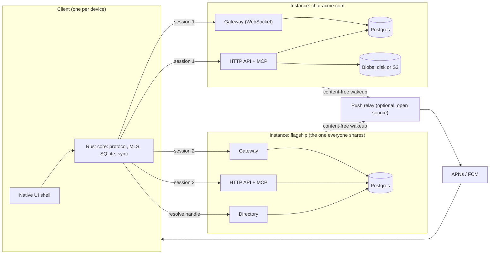

# Lumia Architecture

Status: **accepted direction**, 2026-11-01. This is the source of truth for architectural decisions. Each section records a decision, the alternatives rejected, and why. Change it by editing the decision and its rationale, not by appending exceptions elsewhere.

Sections marked **provisional** state intent and the shape of the guarantee, but need a focused specification before implementation: E2EE backup and rejoin (section 11.3); deployment recovery (section 15). Implementation of a provisional area starts with writing that spec, not with code. Specified so far: identity, devices, and recovery (section 5) in [specs/identity.md](specs/identity.md); permissions, authorization, and revocation (section 7) in [specs/authorization.md](specs/authorization.md); delivery and sync (section 8) in [specs/delivery.md](specs/delivery.md).

Lumia is a chat app: servers with public and private channels, direct messages inside and outside servers. The difference from Discord and Slack is that anyone can self-host an instance, an instance can hold many servers, and one client talks to many instances at once.

## 1. Principles and hard rules

Priorities, in order: security, privacy, performance. When they conflict with convenience, they win.

Hard rules. Any future decision that violates one of these must amend this section first.

1. **Instances are islands.** No server-to-server traffic in v1. The client does all cross-instance bridging.
2. **Self-hosting is two containers.** The Lumia image and Postgres. No Redis, no search engine, no message broker. Everything optional (push relay, TURN, SFU, S3) must have a working default without it, and the doc must say what that default does not do.
3. **No unconfigured outbound calls.** The server makes no network request the operator did not explicitly enable. The push relay is the only Lumia-operated dependency and it is optional.
4. **First-party clients use only the public API.** There are no private endpoints. If a first-party client needs something, the public API gains it.
5. **Scope determines governance.** Server content (channels, server DMs) is readable by the server, its admins, and its bots. Personal DMs are end-to-end encrypted and no server can read them. A conversation has exactly one of these two natures and it never changes.
6. **One edition.** There is no enterprise edition and no feature a self-hoster cannot run. Every feature ships in the AGPL server. Hosted plans sell capacity and convenience, never code.
7. **Guarantees are stated, not implied.** Where this document promises delivery, revocation, recovery, or confidentiality, it states the exact guarantee and its failure mode. "Works" is not a guarantee.

## 2. System overview



An **instance** is one deployment: one Postgres database, one or more homogeneous Elixir nodes, one blob store. An instance hosts many **servers**. A server has channels, roles, members, and server DMs. Users hold **accounts** on instances, each bound to one **identity**, which is a key hierarchy rooted on their devices (section 5). The **flagship** is the instance Lumia operates. It runs the same code as every other instance with no special cases, and additionally runs a **directory**.

A client holds one session per instance it is connected to. The user sees one flat list of servers; the instance is plumbing that surfaces only where trust or routing depends on it (section 6.1).

## 3. Server runtime and clustering

**Decision.** A single Phoenix application (contexts, not an umbrella) released as one OCI image. Nodes are homogeneous and stateless apart from connection processes and presence. Postgres is the single source of truth. Nodes discover each other with libcluster and fan out events with Phoenix.PubSub using the `Phoenix.PubSub.PG2` adapter over Erlang distribution. Presence uses Phoenix.Presence CRDTs, **scoped per server**: one Presence topic per server, and a client is tracked in it only while it has that server's member list or one of its channels on screen. "Online" for Home and DMs is a separate lightweight per-user topic that friends subscribe to. Phoenix.Presence replicates its whole tracked state to a node when it joins the cluster, so the instance-wide number of tracked entries must stay bounded by what is actually on screen, not by who is logged in. Per-node caches are **advisory**: they speed up reads and are invalidated by PubSub, but no authorization decision for a write or a subscription relies on a cache alone (section 7.4). Background work (retention, purge, thumbnails, webhook retries, backup manifests, blob garbage collection) runs on Oban, which is Postgres-backed and participates in application transactions.

Rust is used through Rustler NIFs for work Elixir is the wrong tool for: MLS delivery-service operations, hashing of large inputs, image decoding. The rule for a NIF is: **Rust-only crates, dirty-scheduled when they can run longer than a millisecond, with input bounds checked before the call.** Rustler turns a Rust panic into an Elixir exception and Rust's memory safety rules out the segfaults that make C NIFs dangerous, so the residual risks are scheduler blocking (the dirty flag), memory exhaustion from a decompression bomb (check declared dimensions and input size before decoding), and the rare abort from stack overflow or allocation failure, which pure-Rust iterative codecs do not exhibit in practice. A crate that links C (libwebp, libheif, libavif), and any video work, runs instead in a supervised worker OS process over a Port, because the C risks come back with the C.

**Rejected.**
- *A process per channel or server pinned to one node (Horde, `:global`).* Gives in-memory serialization and hot state but brings handoff on node loss, split-brain on partition, and a cluster-coordination story a single-node self-hoster has to carry anyway. Postgres already serializes writes per channel (section 8).
- *No Erlang distribution, coordinate through Postgres LISTEN/NOTIFY.* Simpler ops but puts every real-time fan-out through the database, which is the one component that does not scale horizontally here. LISTEN/NOTIFY is also a single global queue with an 8 KB payload limit.
- *Redis for PubSub, presence, or rate limits.* Violates hard rule 2.
- *Every parser of untrusted bytes in a Port worker (the first draft).* Correct for C, over-cautious for Rust: it would have moved every image decode out of process to defend against failures Rustler already catches. Kept only for C-linked crates and video.

**Rationale.** Statelessness makes single-node trivially correct and multi-node a configuration change. Erlang distribution is the cheapest reliable fan-out available to an Elixir deployment and costs the operator nothing.

**Consequences.** Transactional state changes live in Postgres. Effects outside Postgres (broadcasts, pushes, webhooks) are at-least-once and idempotent, never exactly-once (section 8). Rate limiting is per node for cheap operations (section 10).

## 4. Gateway and wire protocol

**Decision.** One persistent WebSocket per instance per client, plus HTTP for CRUD and uploads. The gateway runs **one Phoenix channel per connection**: the session, with a custom serializer so that `Hello` is the join, `Welcome` is the join reply, and every other frame is a bare `ClientFrame` or `ServerFrame` with no Phoenix envelope on the wire. Phoenix.Presence and `Phoenix.ChannelTest` come along for free. Subscriptions to chat channels are PubSub subscriptions held by that session process, which are ETS entries, not processes. The session process holds each subscription's cached permission state and its last-delivered `seq` (section 8). This keeps a node with 100,000 connections at 100,000 processes, not 100,000 times the number of joined channels.

Encoding is negotiated by WebSocket subprotocol: **protobuf** for first-party clients, **JSON** for bots that want it. The protobuf schemas in `proto/` are the single source of truth; the HTTP API's OpenAPI document and the clients' types are generated from them.

**The protocol contract is more than the message schemas.** A protocol document under `docs/` specifies, and the generated OpenAPI reflects: HTTP method and path mapping per operation; the error envelope and error codes; authentication headers and token lifetimes; cursor-based pagination; unknown-field handling (ignore on read, never reject); compatibility rules (fields are only ever added, never renumbered or retyped); and that every 64-bit integer, including every `seq`, is a decimal string in JSON, as ProtoJSON specifies, because JavaScript cannot represent them losslessly.

**Rejected.**
- *A Phoenix channel per chat channel per connection.* The natural Phoenix model, but it multiplies processes by joined channels.
- *JSON everywhere.* Debuggable, but six platforms hand-writing types from prose is how protocols drift.
- *gRPC.* Browser support still needs a proxy, and Phoenix Channels already gives the topic and presence model.
- *MessagePack.* Compact but schemaless; same drift problem as JSON.

## 5. Identity, devices, and recovery

Specified in full in [specs/identity.md](specs/identity.md), which owns derivation, the roster's verification order, every flow, conflict rules, limits, and tests. This section records the decisions and their rationale.

### 5.1 The hierarchy

**Decision.** Identity is a key hierarchy, not a single key.

```text
Identity ID        = hash of the first root public key; never changes
Root key           Ed25519, derived from the recovery phrase; offline by default
Device roster      versioned, signed document: authorized device keys, revoked device keys
Device keys        Ed25519 per device; sign everything day to day, including MLS credentials
Instance accounts  authorization on one instance, bound to the identity ID
Sessions           per device per instance; revocable
Recovery phrase    24 words; derives the root key and the backup key
```

- **Adding a device** requires either a signature from an existing authorized device, with approval shown on that device (QR or code), or the root key, which means entering the recovery phrase. The new device gets its own device key. The root private key is never copied to a device as part of this flow.
- **Revoking a device** requires a signature from an authorized device **and** authentication to the instance's own account (password, passkey, or MFA). A thief holding a stolen device therefore cannot win a race to revoke the owner's real devices: they have a device key but not the account credentials.
- **Rotating the root key** is signed by the previous root or by the recovery phrase and chains from the identity ID, so the identity does not change when the key does.
- **Rosters are self-certifying and client-carried.** Every device entry carries a certificate signed by the root or by the device that added it, and every revocation carries the revoker's signature, so any instance can verify any roster version from the bytes alone with no earlier version. On every connect, the client presents the newest roster it holds. An instance accepts a device only if it appears in the newest roster version the instance has seen and is not revoked. Roster versions are monotonic and signed, which gives replay protection and deterministic conflict resolution (highest version wins; a root signature beats a device signature at the same version; revocations win a merge).
- **Revocation is per instance and eventually consistent.** Because instances do not talk to each other, an instance that is unreachable when a device is revoked learns on the next connect that carries the new roster. The UI shows "revoked on 2 of 3 instances" and names the one that has not confirmed. "Globally revoked" is never displayed.

**Rejected.**
- *One identity private key copied to every device.* The first draft of this document took it, and Signal does it for linked devices. With identity-proof sign-in (section 6.3) a copied root key means a stolen device is a permanent account takeover on every instance, and revoking the device's session does nothing about it.
- *Revocation by any device alone.* Lets the thief revoke the owner.
- *Revocation requiring the root key.* Correct but unusable: nobody has the recovery phrase to hand when their phone is stolen.

**Rationale.** MLS needs a credential and signing key **per client**, not a shared key per human; per-device signing keys are the normal MLS arrangement. A portable identity across instances is Lumia's choice, so Lumia has to pay for its revocation story, and this hierarchy is the cheapest one that makes "revoke this device" mean what users think it means.

### 5.2 Directory, handles, first contact

**Decision.** A **directory** maps a handle (`@ryan`) to an identity ID, its current root public key, its rotation chain, and its latest roster version. The flagship runs one; any instance may run one; none is required. The address `user@host` always resolves at that host without any directory. A client that creates a new identity also creates a flagship account unless the user declines, and in v1 the flagship directory is simply its account table. An identity with no flagship account is reachable only through the hosts it has accounts on.

**First contact is trust-on-first-use.** A directory answer proves which key holds a handle *now*; it does not prove the key belongs to the person the user expects. Clients pin the key on first contact, warn loudly on any change that is not a valid rotation chained from the pinned key, and show safety numbers for manual verification. Key transparency (an append-only, auditable log) is deferred.

**Device changes are visible.** When a contact's roster gains a device, the client shows "added a new device" in the conversation and re-verifies the roster signature against the pinned root key. A device added by a valid roster update is not a key change; a roster signed by an unknown root is.

**Multiple identities.** A client can hold several identities, for example a work identity and a personal one, with one as default. Using one identity across work and personal instances is a correlation mechanism, and the choice to correlate belongs to the user.

**Directory operations in v1.** Register handle, resolve handle, publish roster version, rotate key.

### 5.3 Recovery

**Decision.** The recovery phrase (24 BIP39 words) derives the root key and a separate **backup key** by HKDF, so the phrase alone recovers everything and no server holds anything the root depends on. Losing all devices: enter the phrase, derive the root, sign a new roster that revokes the old devices and contains a fresh device key, present it to each instance; root-signed rosters bypass the reauth rule. History recovery is section 11.3. The **encrypted identity backup** (the roster, pinned contact keys, block list, profile, hosts) is small ciphertext under the backup key, stored on every instance the identity has an account on, so recovery needs any one of them. No host can read it. Adding a device when one already exists needs no phrase: the existing device approves a QR, signs the certificate, and hands over the backup key in an encrypted link bundle claimed with a short code. Web devices never receive the backup key.

## 6. Servers, channels, DMs, and what the user sees

### 6.1 Instances are invisible

**Decision.** The client renders one flat rail of servers across all connected instances, plus a Home that aggregates personal DMs, friends, Saved, Mentions, and Threads across all of them. The instance appears in exactly these places:

- The join flow. An invite URL carries the host. Joining a server on an instance you have no account on shows that host's About and trust card **first** and requires an explicit tap before the client sends anything; only then is an account created, bound to your identity and subject to that instance's sign-in policy (section 6.3). The identity proof is a signed challenge that includes the hostname, so a proof collected by one host cannot be replayed to another. Connected-channel invites (section 6.5) are gated the same way. A URL alone never causes the client to hand a host an identity proof or a profile.
- Account settings, as a list of hosts, each with its sessions and devices.
- The About card of a server and of a connected channel, with a trust note: "Operated by Acme Corp. Acme can read channel messages and server DMs, not your personal DMs."
- A host label on a member or DM request when the host is not the one the viewer expects.

**Rejected.**
- *Instance-first navigation (rail grouped by instance).* Honest, but it makes a self-hosted server feel second-class and exposes plumbing nobody asked about.
- *A badge on every server from a non-flagship host.* Deferred to design; revisit if hidden hosts cause confusion.

**Rationale.** "One flat list, joining is a URL" is the self-hosting pitch in a single gesture. The trust note is where privacy becomes visible instead of implied.

### 6.2 Accounts, members, guests

**Decision.** `accounts.kind` is `human | bot`. Guest status is a property of **membership**, not of the account: `server_members.kind` is `member | guest`. One account can be a member of server A and a guest of server B on the same instance, and promoting the guest on B changes nothing about A. Instance-wide abilities (create servers, send invites, use the public directory) are account policy set by the operator, not kind.

A **guest membership** sees only the channels granted by explicit per-channel overwrites, never the full member list or the server directory. Guests cannot invite or start server DMs outside their channels unless granted. A guest membership may carry an expiry and can be promoted by an admin. Two ways in: proof of ownership of an existing identity (no password, profile imported), or an email invite that creates a new identity on first sign-in. Guests are not seats for entitlements; plans cap active guests instead.

**Rejected.** *`guest` as an account kind.* The first draft did this. It cannot represent an employee on one server who is a contractor on another, and promotion would have instance-wide effect.

**Rationale.** One mechanism, identity-bound guest memberships, serves contractors and connected channels (section 6.5).

### 6.3 Identity proof and instance policy

**Decision.** *Identity proof establishes which identity is requesting access. It never overrides an instance's or a server's authentication, provisioning, or membership policy.*

- Each instance sets whether identity proof alone may **create** an account or **sign in**. Default on for the flagship and community instances. An operator who requires OIDC turns it off; then a user who still holds their identity key gets nothing from it once the employer disables their OIDC account.
- **Linking** an existing account to an identity requires both the account's own authentication and a signature from the identity. Matching an email or a profile is never sufficient.
- Authentication methods in v1: password (Argon2id), magic link, passkeys (WebAuthn), OIDC login. MFA via TOTP or passkey. SAML, SCIM provisioning, and group sync are planned for the same codebase after v1 (hard rule 6).
- Sessions are opaque random tokens, stored hashed, one per device per instance, with a short-lived access token and a long-lived refresh token, so revocation from the device list takes effect within the access-token lifetime. A session is bound to a device key in the roster; a revoked device's sessions die with it. Revoking a session or a device **broadcasts over PubSub and the session process closes the socket**; a WebSocket authenticated an hour ago does not get to wait for its access token to expire. Token expiry is the backstop, not the mechanism.

**Rejected.** *JWT sessions.* Stateless validation is not worth losing fast revocation and a device list that is actually authoritative.

### 6.4 Two kinds of DM

**Decision.** A DM is either a **server DM** or a **personal DM**, and never changes kind.

| | Server DM | Personal DM |
|---|---|---|
| Lives on | The server's instance | The instance where it was started, which the client picks: the flagship if both have accounts there, else a shared instance |
| Content governance | The server: retention, moderation, admins | The participants only: content confidentiality and membership |
| Service governance | The hosting instance | The hosting instance still controls availability, suspension, quotas, and service retention |
| Encryption | At rest, server-readable | End-to-end (MLS) |
| Bots | Allowed | Only as a full MLS member the participants add |
| Gate | Shared membership of the server | Friendship, or an accepted DM request |
| Shown in | That server's sidebar | Home |

The same two people can have both. The client offers "Move to personal DM" on a server DM, which starts a new personal DM and links to the old one; it does not move history across the governance boundary.

**Rejected.** *One DM per pair per instance, shown in both places.* A work DM and a private DM have different owners; collapsing them forces one of them to have the wrong governance.

**Where personal DMs live.** Personal DMs are an instance feature, not a flagship feature: every instance supports E2EE personal DMs between its own accounts, because the flagship runs the same code with no special cases. The flagship is the **global** place for personal DMs only because everyone has an account there by default. You can personally DM anyone you share an instance with, and the flagship is the instance everyone shares. Nothing routes between instances.

**Placement is deterministic**, because two clients can start the same DM concurrently on different hosts. Both compute the same rule: the flagship if both have accounts there, else the shared instance whose normalized hostname sorts lowest. Each instance enforces a uniqueness constraint on personal DMs with exactly two participants, keyed on the sorted pair of identity IDs, and returns the existing conversation on conflict. If clients later discover duplicates on different hosts, created with stale knowledge of each other's accounts, the one on the rule-chosen host wins and the other is shown as linked history. Group DMs are exempt: one person creates them and they have an ID. An existing personal DM on a non-chosen instance still shows in Home, labelled by host. A person with no flagship account has personal DMs only on the instances they share with the other person. An isolated instance whose users have no flagship accounts works fully air-gapped, with E2EE personal DMs among its own accounts.

**Costs, stated plainly.** For every personal DM on the flagship, Lumia sees what section 11.1 lists as visible. Two people on two isolated instances with no flagship accounts cannot DM each other at all, which is the isolation those operators chose.

**Rejected.**
- *A home host per identity, with DM-only guest accounts created on the recipient's host to deliver requests from strangers.* Reaches anyone on any host, but adds host selection, a guest-session flow for DMs, an operator setting, and a reachability rule, all to serve the case of two people who share no instance and refuse the flagship. Recorded in section 19 as the path if that case ever matters.
- *DM-only federation (instances relay E2EE ciphertext to each other).* Simpler than Matrix because servers never interpret content, but still a server-to-server protocol with cross-host key fetching, inter-host spam, and availability coupling. Violates hard rule 1.

#### Friends, DM requests, and blocking

**Friendship is per instance.** A friendship is a row between two accounts on one instance; nothing else is possible without federation. Because both accounts are bound to identities, the client shows friends across all connected instances as one list in Home, labelled by host only when ambiguous.

**Who needs a request.** Starting a personal DM requires friendship or an accepted DM request. By default, sharing a server does not skip the request. Each user can loosen this per instance ("allow DMs from members of servers I'm in"), and a server can additionally declare that its members may DM each other without a request. Server DMs never need a request; server membership is the gate.

**A request carries no message content.** The recipient sees the sender's handle, host, shared servers, mutual friends, and signed profile, then accepts, declines, or blocks. No MLS group exists until accept, so a stranger cannot push ciphertext, key packages, or attachments at someone who has not agreed to talk.

**Accepting creates the group.** On accept, the recipient's client fetches the sender's key packages and creates the MLS group, so the person who said yes initiates the cryptography. Accepting a DM request does not make the two people friends; a friend request is separate.

**Group DMs.** Adding someone to a personal group DM requires that the adder be friends with them or have an accepted DM with them. The group sees who added whom.

**Decline and block.** Decline is silent and permits one further request after a cooldown. Block refuses future requests at the host before anything is created, hides the blocker from the blocked person's member lists, and is per identity, so it covers every account that identity links on the instance.

**Blocks across instances.** A block is stored on the instance where it was made, since nothing else is possible, but the client also keeps a block list keyed by identity ID in the encrypted identity backup (section 5.3). The client applies that list locally on every instance, hiding content and auto-declining requests, and pushes it to each instance where the user has an account on the next connect, so a block made on the flagship takes effect on every other host the user uses.

### 6.5 Connected channels across organizations

**Decision.** A channel shared between two organizations lives on one instance, the **host**. The other organization's people join through identity-bound guest memberships on the host. Flow: Org A's admin creates a connect invite for the channel; Org B's admin accepts it and picks members; each picked member's client proves identity to A and receives a guest membership scoped to that channel. The channel appears in the guest's rail under the host's server tile with a "Guest" badge. The About card states that the host owns the data and its retention and moderation apply.

**Offboarding.** Org B's instance does not know its people are guests at A, so B disabling an employee does **not** remove that person's guest membership at A. The doc does not pretend otherwise. Connected-channel guest memberships therefore **expire** (default 90 days) unless Org B's admin renews them by re-attesting the member list, and A's admins can revoke any guest at any time. Home-organization offboarding does not propagate; expiry bounds the damage.

**Rejected.** *Replicated channels synced server to server.* Both orgs would get governance, but it brings conflict resolution, dual retention, dual moderation, and an inter-instance protocol. Violates hard rule 1. Deferred for the case where host-only governance is unacceptable to enterprise buyers.

**Known gap.** B's admins cannot audit which external channels their people are in. Deferred, solvable either by the client reporting memberships to the organization's own instance or by replication.

### 6.6 Threads, reactions, invites, feature scope

**Threads.** Slack-style. A reply is a message in the same channel whose `parent_id` points at the root. The root carries a denormalized thread summary. A reply may also be posted to the channel. No thread-as-channel. Threads work in every channel kind including DMs.

**Reactions.** A reaction is a short string key into a per-instance **reaction registry**, seeded with the four built-ins (thumbs up, check, heart, sparkle). Reactions are not Unicode emoji; the product keeps emoji out of the interface chrome while allowing them in message text.

**Invites and discovery.** Invite links carry the host, an optional expiry, and an optional use count. Each instance may run an opt-in public server directory. Cross-instance discovery is out of scope.

**v1 message features.** Text with formatting, mentions, attachments, reactions, threads, pins, Saved, typing indicators, presence (online, away, do not disturb, custom status text), unread and mention counts at every level, join system messages, edit, delete, 1:1 voice calls.

Edit keeps history server-side for server content (visible to moderators). Delete writes a tombstone event; content is retained 30 days (instance-configurable) for moderation, then purged (section 8.5). Per-server retention policies are a scheduled job that writes tombstones, so retention and deletion share one code path. For personal DMs, edit history and deletion are client-side matters since the server holds only ciphertext.

Deferred: read receipts, link unfurling, custom emoji in text, voice channels, video, screen share.

## 7. Permissions, authorization, revocation

Specified in full in [specs/authorization.md](specs/authorization.md), which owns storage, the resolution function and its reference implementation, the snapshot cache, the two propagation paths, instance administration, bot scopes, the audit log, limits, and tests. This section records the decisions and their rationale.

### 7.1 Roles

A server has roles. A role has a permission set expressed as named flags in the API (bitfield only as a storage detail). A member has many roles. A channel can override permissions per role or per member. A private channel is a channel whose overwrites deny `@everyone`. A member's display tag is their highest-priority role. Instance administration is a separate layer above servers and is not reachable through server roles.

### 7.2 Resolution algorithm

Deterministic, in this order:

1. Start with the union of permissions from all of the member's roles, including `@everyone`.
2. If the result includes Administrator, stop: everything is allowed, overwrites are ignored.
3. Apply the channel's `@everyone` overwrite: remove its denies, add its allows.
4. Aggregate all overwrites for roles the member holds: remove the union of their denies, then add the union of their allows.
5. Apply the member-specific overwrite: remove its denies, add its allows.

Within a layer, deny is applied before allow; a later layer overrides an earlier one. The server owner has Administrator implicitly.

### 7.3 Guest access

Guests start from an empty permission set rather than `@everyone`, and gain access only through step 4 and 5 overwrites. Nothing in a guest's resolution ever consults `@everyone`.

### 7.4 Authorization and revocation

**Decision.** Caches are advisory; Postgres is authoritative. Two propagation paths, both at-least-once:

- **Definition-level changes** (a role's permissions, overwrites, a channel made private, ownership) bump `acl_version` on every affected channel in the same transaction and are carried on every broadcast event. A session whose cached version differs re-resolves before delivering and drops the subscription if access is gone.
- **Member-level changes** (roles assigned, a kick, a guest expiring) do not bump `acl_version`; they append to the affected member's account log, whose `seq` and reconciliation give the same guarantee. The member's sessions re-resolve or unsubscribe on receipt.
- **Writes** are checked against Postgres on every request.
- **Partition healing.** After a node rejoins the cluster, every session on it re-resolves all subscriptions before delivering anything.
- **Bounded staleness.** A subscription not re-resolved in ten minutes is re-resolved before its next delivery.

**Rejected.** *Bumping `acl_version` on member-level changes.* Correct but a re-resolution storm across every session in a large server on every role assignment.

**Failure mode, stated.** A removed member's stale session can exist for at most one reconciler tick plus the staleness bound, but no event committed after the removal can be delivered through it, because any such event either carries a new `acl_version` or arrives after the account-log nudge.

## 8. Delivery and sync

Specified in full in [specs/delivery.md](specs/delivery.md), which owns the tables, the session process, the replay loop and its cap, reconciliation, resume outcomes, purge, timings, and tests. This section records the decisions and their rationale.

### 8.1 The event log

Every channel and every DM is an append-only **event log**. The server assigns a per-channel monotonic bigint `seq` on write by locking the channel row (`UPDATE channels SET last_seq = last_seq + 1 ... RETURNING last_seq`) inside the same transaction that inserts the event and updates any materialized state. Event kinds for server content: message created, edited, deleted, reaction added, reaction removed, pinned, unpinned, member joined, member left, thread summary updated, `acl_version` changed. For personal DMs the only kinds are application message and control message (section 11.1). Messages are materialized into a `messages` table from events for query convenience, but `seq` on the event is the ordering and the sync cursor.

**Ordering rules.** Lock the channel row, insert the event, update materialized state, **commit, then broadcast**. Never broadcast inside the transaction: another node would deliver an event that a scrollback query cannot yet return. Never release the lock before commit: a reader could see `seq` 1044 committed while 1043 is still in flight, advance past it, and never fetch it. A consequence worth stating: every write to one channel serializes on one row, so a single hot channel is bounded by Postgres commit latency, and that latency is the floor under the send budget in section 17.

**Growth.** Event rows are permanent (8.5). The events and payloads tables are **hash-partitioned by `channel_id`** from day one (Postgres native partitioning, 32 partitions), so the `(channel_id, seq)` range query and the `(channel_id, command_id)` idempotency lookup each prune to one partition. Tiny instances carry the partitions harmlessly; retrofitting partitioning onto a large table is a rewrite. Time partitioning is rejected because it defeats pruning on the sync query.

An **account-level event log** per instance, with its own `seq`, records what a client cannot learn from channel logs it does not yet know about: memberships added or removed, channels and DMs created or deleted, role changes, device roster updates, profile changes, friend and DM request state.

**IDs.**
- **Every command carries a client-minted UUIDv7 command ID.** Message creation uses the message ID as its command ID; edits, reactions, pins, and membership changes each get their own. This is what makes retries safe.
- **All server-minted IDs are UUIDv7 with Ecto's monotonic precision** (`Ecto.UUID.generate(version: 7, precision: :monotonic)`, Ecto 3.14+). Strictly monotonic per node via a node-global counter in the twelve `rand_a` bits. Postgres 18's native `uuidv7()` gives the same guarantee per backend; the app mints instead because it needs the ID before the round trip, not because either is more monotonic than the other.
- **`created_at` is its own column.** The monotonic counter can run ahead of wall clock under burst, and client clocks skew, so no code may derive time from an ID.

**Rejected.**
- *UUIDv7 as the ordering.* Not monotonic across nodes, meaningless for client-minted IDs, and a UUID can never tell a client that it missed one.
- *A global sequence.* Serializes every write in the instance through one hot row.
- *A transactional outbox with a dispatcher.* Correct, but a second table and a dispatcher to get a guarantee that reconciliation (8.2) provides at lower cost.

### 8.2 The delivery contract

**Invariant.** *A successful send acknowledgment means the event and its immediately queryable state have committed. Live delivery is at-least-once and recoverable, never exactly-once. Clients deduplicate by event ID.*

Three mechanisms together make that true:

1. **Fast path.** The session process that committed the event broadcasts it over PubSub with its `seq` and `acl_version`. Phoenix delivery is at-most-once; this path alone can lose an event if the process dies between commit and broadcast, or across a partition.
2. **Per-node reconciliation.** Every node keeps, per subscribed channel, the highest `seq` it has delivered. Every interval (seconds) it runs one query for channels whose `last_seq` changed since the last interval (indexed on the channel's `last_seq_at`), compares, and for any mismatch pushes "channel X is at N" to the affected sessions, which fetch the gap. Cost is proportional to write rate, not to subscriptions.
3. **Client high-water-mark check.** When the app comes to the foreground or regains connectivity, the client sends its cursors for all channels in one request and receives the current `last_seq` for each.

**Gap detection.** Every broadcast carries `seq`. A client that receives `seq` N+2 while holding N fetches N+1 before applying N+2. Events are applied in `seq` order; a fetched event already applied is dropped by ID.

```mermaid
sequenceDiagram
  participant C as Client (Rust core)
  participant G as Gateway node
  participant P as Postgres
  participant O as Other nodes

  C->>G: send(command_id=uuidv7, channel, body)
  G->>P: BEGIN; lock channel row; INSERT event; UPDATE messages; COMMIT (seq=1042)
  P-->>G: seq=1042
  G-->>C: ack(command_id, seq=1042)
  G->>O: PubSub broadcast(event, seq=1042, acl_version)
  O-->>C: event 1042 (to other devices)

  Note over G: Gateway dies after commit, before broadcast of 1043
  Note over O: Reconciliation tick: channels changed since last tick
  O->>P: SELECT id, last_seq FROM channels WHERE last_seq_at > $since
  P-->>O: channel at 1043
  O-->>C: "channel at 1043"
  C->>O: fetch(channel, 1043..1043)
```

### 8.3 Idempotency rules

For any command ID the server has seen:

```text
Same ID + same actor + same channel + same operation  → return the prior result
Same ID + any difference                              → reject
Same ID on content the actor cannot access            → respond as if the ID were unknown
```

Command IDs are retained for at least the retention window of the channel. For E2EE commands, a retry resends the **original ciphertext**. If the MLS epoch has advanced and the original can no longer be delivered, the client abandons that command ID and re-encrypts under a new one; the old ID is never reused with different bytes.

### 8.4 Resume

A client resumes each channel from its last applied `seq`, and the account log from its last applied account `seq`. Three outcomes:

```text
Cursor still served          → incremental replay of events after the cursor
Cursor no longer served      → snapshot of current state plus a new cursor
Recovery generation changed  → discard all cursors, snapshot everything
```

"No longer served" is a replay cap, not purged rows: event rows are permanent, but a cursor more than 1,000 events behind the head is answered with a snapshot rather than a stream.

The **recovery generation** is one integer in instance configuration that an operator bumps after restoring the database from a backup. It is sent on every connect; a client whose stored generation differs does a full reconcile, because `seq` values after the restore point may now refer to different events.

Reconnect refetches only when the cursor is no longer served. A fresh install and a lost local database take the snapshot path.

### 8.5 Append-only versus purge

Event rows are permanent: ID, kind, actor, `seq`, `created_at`, `acl_version`. Payloads live in a separate `event_payloads` table. Deletion and retention **null the payload**, so the event becomes a tombstone without breaking ordering or gap detection. Purge covers, in the same job: the search index entry, the attachment references (and the blob, once unreferenced, section 12), and server-side database backups on their own retention schedule. A tombstone event carries a client-cache instruction so caches drop the body too.

## 9. Public API, bots, agents

**Decision.** REST plus JSON at `/api/v1`, OpenAPI generated from `proto/` per the protocol contract (section 4). Hard rule 4 applies. Bots authenticate with scoped tokens; user-authorized integrations use OAuth 2.1 with PKCE. Outgoing webhooks are HMAC-signed with a per-webhook secret. Slash commands and interactive components are registered through the API, Discord-style.

**MCP.** Each instance exposes a Model Context Protocol server at `/mcp` (Streamable HTTP transport), implemented inside the Elixir app, authenticated like the API. Tools map to the public API. Agents are bot accounts with a visible "agent" badge and the same role-based permissions as any member. An agent can join a personal E2EE DM only as a full MLS member that the participants add.

**Plugins.** Instance-side plugins running sandboxed in the server (WASM via Wasmex) with capability-based permissions are designed for but not built in v1.

## 10. Rate limiting and egress

**Rate limiting.** Per-node token buckets in ETS (Hammer) for cheap operations like message sends, accepting that N nodes are N times more lenient. Postgres-backed limits for expensive or abuse-prone operations: signup, invites, password reset, DM requests to non-friends. Redis was rejected under hard rule 2; this is the cost.

**Egress.** Hard rule 3 means the operator **enables capabilities**: outbound webhooks, OIDC discovery, SMTP, S3, the push relay, link fetching (deferred). Within an enabled capability, **user-supplied destinations** (webhook URLs, OIDC issuer URLs) are resolved and filtered against private, loopback, link-local, and metadata address ranges before any connection, with DNS rebinding handled by connecting to the resolved address. Operators may allowlist private destinations explicitly.

## 11. End-to-end encryption

### 11.1 What is encrypted and what is not

**Decision.** Personal DMs and personal group DMs are end-to-end encrypted with **MLS (RFC 9420)** using OpenMLS: natively in the client's Rust core, and via Rustler on the server for delivery-service duties (key package storage, welcome and commit ordering, epoch bookkeeping, GroupInfo storage for external joins). The delivery service is never a group member. Server channels and server DMs are encrypted at rest only.

**Personal DM events are opaque.** The shared event schema does not decide what leaks. For a personal DM the server stores and sees exactly:

```text
conversation ID, sender device ID, seq, created_at, ciphertext size,
one bit: application message | MLS control message (needed for push and ordering)
```

Reactions, edits, deletes, thread relationships, mentions, pins, read state, and attachment metadata are all **inside** the ciphertext as application-level operations. Clients validate those operations and maintain the decrypted projections (message list, thread summaries, reaction counts) locally. The server maintains no projection of personal DM content.

**What the hosting instance still knows and controls**, stated so that no claim of "nothing else" is made: the accounts and identities in the conversation, their device IDs and roster versions, session and connection metadata (IP, user agent, times), message timing and sizes, the key packages and GroupInfo it stores, quotas, suspension, and service-level retention of the ciphertext. If the push relay is enabled, the relay additionally observes device, instance, and push timing (section 15.5).

**Rejected.**
- *E2EE everywhere including channels.* Loses **server-side** search, moderation, retention enforcement, and automation; bots as explicit MLS members would still work, as they do in personal DMs. The self-hoster already owns the server, so E2EE inside a server protects against the one party who has already been trusted with it.
- *No E2EE in v1, self-hosting as the privacy story.* The flagship is where global personal DMs live; without E2EE, Lumia would read them.
- *Signal's double ratchet.* Pairwise ratchets scale poorly to groups and multi-device; MLS is designed for both.

### 11.2 Devices in MLS

Each device is an MLS leaf with its own device key (section 5.1) as the credential's signing key. Adding a device to the identity (roster) and adding its leaf to each group are separate steps; an existing device performs the group adds. MLS state and queued outbound messages are persisted crash-safely in the device's SQLite store before any network send, so a crash never produces a leaf that has advanced an epoch it cannot resume.

### 11.3 History backup and rejoin — provisional

**Decision.** The host cannot build a backup of what it cannot read, so **clients construct it**. Each device appends encrypted **history chunks** under the backup key (derived from the recovery phrase, section 5.3) and publishes a signed **manifest** (device key signature, monotonic version, chunk list, covered conversations and ranges). Concurrent devices write independent chunks; restore takes the union, deduplicates by message ID, and restores only conversations the identity was a member of at the time. Chunk and manifest deletion follows the user's deletion of the underlying messages; backup rotation on recovery-phrase change re-encrypts manifests, not chunks, by wrapping the chunk keys.

**Live MLS state is never restored from backup.** A recovered device gets a fresh device key, is added to the roster (section 5.3), and joins each group fresh: by an existing device adding it, or, when no device remains, by an **external commit** using the GroupInfo the delivery service stores. Other participants see a "device recovered" notice, and their clients re-verify the identity's root key against the pinned one.

**Privacy claim, qualified.** Retained history is only as confidential as the recovery phrase. MLS provides forward secrecy and post-compromise security for live traffic; an encrypted archive by its nature reduces those guarantees for whatever it retains, and the doc and the product say so where users turn history backup on.

### 11.4 Web client

**Decision.** A browser session is a **web device**: its own device key, scoped to the **origin** that served the client.

- The flagship's web origin may connect to many instances, because Lumia controls its code distribution.
- A self-hosted instance's web origin connects to **that instance only**. Its JavaScript therefore never sees a device key that works anywhere else.
- The root key never enters a browser. Linking a web device requires approval from a native device (or the recovery phrase).
- Keys are held as non-extractable WebCrypto objects where the algorithm allows it. This limits exfiltration of key bytes; it does **not** stop the page's own code from using the keys or reading plaintext. The trust boundary for a web client is the origin operator, full stop, and the device list labels web devices as such. HPKE, which MLS depends on, is not in WebCrypto, so a WebCrypto-backed OpenMLS provider is partial at best; some key material will live in WASM linear memory. An out-of-band code-verification browser extension, the only real mitigation for origin trust, is deferred.
- Storage is SQLite WASM on OPFS in a dedicated worker, with Web Locks electing one tab as owner; the doc notes that browsers may evict OPFS under storage pressure and the client treats a lost local store as the snapshot path (8.4).

**Rejected.**
- *Subresource integrity as a defense.* SRI verifies resources against hashes in the HTML; the party serving the HTML sets the hashes. It defends against a compromised CDN, not against the origin.
- *No E2EE on web.* Pushes people to worse tools.

**Proof obligation (section 20).** OpenMLS builds for wasm32 but does not test it, and ships no WebCrypto-backed crypto provider. The browser key-storage model above must be demonstrated against OpenMLS's provider traits before this section leaves provisional status.

## 12. Storage, attachments, search

**Attachments.** Blobs are stored under **application-level envelope encryption**: each blob has a random content key, wrapped by an operator-supplied **instance master key** (a file or environment secret in v1; KMS later), so the storage provider never sees plaintext. For personal DM attachments the client encrypts first with a per-file key carried in the MLS message, and the server's envelope wraps ciphertext it already cannot read.

The content address is a **BLAKE3 hash of the stored ciphertext**, keyed with a **per-server key derived from the instance master key** for server content. Deduplication therefore happens within a server only, and the existence oracle that content addressing creates (upload a file, learn whether it was already there) is scoped to people who can already upload to that server. Personal DM blobs are client-side ciphertext and carry no oracle. The hash is a **storage key, not an authorization**: every retrieval is access-checked against the referencing message's channel. References are counted; a blob is garbage-collected by Oban when its last reference is purged.

Server content is processed by dirty-scheduled Rust NIFs (section 3): thumbnails, EXIF stripping, with declared dimensions and input size checked before decoding, and bounded concurrency. Formats whose decoder links C go through the Port worker instead. EXIF stripping is on by default everywhere, done client-side for personal DMs. Upload size limits come from entitlements (section 16).

**Search.** Server content is searched with Postgres full-text search (tsvector with GIN indexes, pg_trgm for fuzzy matching). Results are **filtered by channel ACL at query time**, using the same resolution as reads (section 7.2) for the requester at that moment, never at index time; cross-server search on one instance is exactly where private-channel content leaks otherwise. Personal DMs are searched on-device with SQLite FTS5 in the Rust core. The client's search merges both result sets and labels them. ParadeDB's pg_search is the optional upgrade; a separate search engine was rejected under hard rule 2.

**Local stores.** The client's SQLite database is encrypted with a key held in the platform keystore (Keychain, Android Keystore, DPAPI, Secret Service) and is wiped on logout and on device revocation when the device is online to receive it.

### 12.1 Account deletion and erasure

**Decision.** Deleting an account on an instance removes: the profile and overrides, sessions, device bindings, key packages and GroupInfo contributions, friend and block rows, the identity backup and history chunks stored there, the search index entries for the user's own content, and every blob reference held only by the user's personal content (the blobs follow by garbage collection). Other MLS members see a leave.

Server messages **remain**, attributed to a deleted-user placeholder, so other people's conversations keep their shape. The user may choose **"also delete my messages"**, which writes tombstones for every message they authored through the normal purge path (8.5), including search index and blob references. Operators have an **erasure command** that performs the full tombstone path for an account regardless of the user's choice, for legal compliance.

Deleting an **identity** is separate and done per instance by deleting each account. The directory releases the handle after a 30-day grace period so a mistaken deletion can be reversed and so the handle is not immediately re-registrable by someone else.

**Rejected.** *Deleting server messages by default.* Removes other people's context and is not what Discord or Slack users expect; the explicit option covers the people who want it.

## 13. Clients

**Decision.** A shared **Rust core** owns everything that must be correct: protocol encode and decode, MLS, the local SQLite store, the sync engine, notification handling, and search over local content. Thin native UI shells sit on top:

| Platform | UI | Core |
|---|---|---|
| macOS, iOS | SwiftUI | Native, via UniFFI |
| Android | Jetpack Compose | Native, via UniFFI |
| Windows, Linux | Tauri shell running the web UI on the system webview | Native, in-process |
| Web | Same UI as the Tauri shell | WASM |

**Rejected.**
- *One cross-platform toolkit everywhere (Flutter, Electron).* Performance is the first priority and Electron's memory footprint is disqualifying.
- *Fully independent native apps.* Six implementations of MLS and sync is how E2EE bugs happen.
- *Rust-native desktop UI (Slint, Iced, GPUI).* Still weak on rich text, IME, and accessibility. Named as the upgrade path if webview performance becomes the bottleneck.

**Linux.** Tauri on Linux means WebKitGTK, the weakest of the system webviews for GPU compositing, Wayland, and raw performance. Linux is therefore where the "webview is the bottleneck" trigger fires first, the budgets in section 17 carry a Linux row, and the Rust-native path would start there.

**Local-first.** Every connected instance's data the user has seen is in SQLite and readable offline. Sends are optimistic with client-minted command IDs. Reconnect resumes from cursors per section 8.4.

## 14. Voice and video

**Decision.** 1:1 calls are peer-to-peer WebRTC with the instance providing signaling. **TURN is operator-configured in v1** (coturn or a hosted service). The promise is stated exactly: *calls are available without TURN; calls are reliable across restrictive networks only when TURN is configured.* The instance tells clients whether TURN is present so the UI can say why a call failed. Group voice, video, and screen share go through an SFU, configured as an endpoint: the flagship points at a Lumia-hosted SFU, self-hosters point at their own. Nothing beyond the signaling path is designed here.

**Goal.** Bundle a TURN server in the Lumia image so calls are reliable under hard rule 2. `elixir-webrtc/rel` (Apache-2.0, Elixir) is the candidate; it is self-described as early stage with no releases yet, so v1 does not depend on it.

**Rejected.** *A required SFU or TURN container.* Violates hard rule 2. *Claiming calls "work" without TURN.* Violates hard rule 7.

## 15. Deployment, push, telemetry — provisional for recovery

### 15.1 Profiles

**Single-node.** The Lumia image, Postgres, blobs on a persistent local volume, the instance master key and other secrets on a persistent volume, and off-host backups of both the database and the blob volume. This is the two-container default.

**Multi-node.** The same image on N nodes with libcluster configured, **plus** a shared blob store, which is a precondition, not an option: S3-compatible storage or a shared filesystem. Local-disk blobs are refused when clustering is enabled. Postgres availability (replicas, failover) and per-node connection-pool sizing are the operator's configuration and the doc gives recommended values.

### 15.2 Encryption at rest, stated by responsibility

| Data | Who encrypts | Mechanism |
|---|---|---|
| Blobs | Lumia | Envelope encryption under the instance master key (section 12) |
| Personal DM content and history chunks | The clients | MLS and the backup key; the server never has plaintext |
| Postgres data files, WAL, database backups | **The operator** | Filesystem or block-device encryption, encrypted backup storage. Lumia does not provide this and says so in the install guide |
| Instance master key | The operator | File or environment secret; KMS integration later |
| Client local store | Lumia | Platform keystore key (section 12) |

### 15.3 Backups and recovery

The install guide defines a backup as **database plus blob store plus instance master key**, taken together; a database backup without the master key cannot decrypt a single attachment. The `lumia backup` and `lumia restore` commands produce and consume exactly that set and verify blob references against the database on restore. Restore bumps the recovery generation (section 8.4). Recovery objectives (RPO, RTO) are the operator's to choose; the guide gives the mechanism.

### 15.4 Upgrades

Migrations run on boot behind an advisory lock, which prevents two runners, not incompatibility. Schema changes follow **expand and contract**: a release may only add columns, tables, and indexes that the previous release tolerates; destructive changes ship one release after the code stopped depending on the old shape. Nodes of release N and N-1 may coexist during a rolling upgrade; N-2 is unsupported.

### 15.5 Push

APNs and FCM only accept pushes signed with the app's credentials, so a self-hosted instance cannot push to the official apps alone. Lumia runs an open-source **push relay**. Instances forward **visible** pushes with generic content ("New message") and `mutable-content` set; the app's notification service extension (and the Android equivalent) fetches and decrypts the real content on device over the app's own session, and falls back to the generic text if the fetch fails. The extension and the app share the MLS store and SQLite database through an app-group container under a **single-writer lock**: whichever process decrypts persists the advanced MLS state before returning, and the other reloads before its next operation. Advancing a ratchet from two processes is a known source of E2EE bugs and the lock is the rule, not an optimization. Background, content-free wakeups are **not** used for message notifications because iOS treats them as low priority and may throttle or drop them.

The relay payload carries an opaque device push token, an instance identifier, and nothing else. Push tokens are **pseudonymous routing identifiers**: they do not carry content or account identity, but they are stable per device. **The relay is a metadata observer**: it sees which device, from which instance, received a push at what time, and can correlate those over time. The privacy posture (section 11.1's visibility list) names it as such. Android additionally supports UnifiedPush with no relay. Browsers and desktop use Web Push (VAPID) run by the instance itself. Anyone can run their own relay and point their own build at it.

### 15.6 Telemetry

OpenTelemetry traces and metrics plus a Prometheus endpoint for the operator. Update checks and anonymous instance statistics are opt-in. Hard rule 3 applies.

## 16. Licensing and entitlements

**Licensing.** The server is AGPL-3.0. The client core and the protocol schemas are Apache-2.0 so third-party clients and bots are unencumbered. There is one edition (hard rule 6): SSO, SCIM, compliance export, audit log, and retention policies all ship in the AGPL server when they are built. Revenue comes from hosted plans on the flagship, which sell storage, call capacity, history, and operations, never features. No license keys exist.

**Rejected.**
- *Open core with a commercially licensed enterprise directory.* A second edition splits the codebase, the community, and the trust message, and hosted plans can carry the business without it.
- *A custom "free under N users" license.* Not open source, unenforceable, chills contributors, blocks distro packaging.
- *Fair Source / FSL.* Does not express a user cap and forbids competing hosted offerings.
- *Permissive everything for the server.* AGPL keeps hosted forks honest about sharing changes.

**Entitlements.** Three different things, kept apart:

- **Operator hard limits**: the ceiling an instance enforces regardless of plan (max upload size, total storage).
- **Plan allowances**: what a plan grants, attached to an instance, a server, or a user.
- **Governance policies**: retention, who may invite, guest expiry. Set by admins; **never** an entitlement, so no plan can override a server's retention policy.

**Who pays.** Content in a server is the server's: the server's plan sets the upload cap and the storage counts against the server. Content in a personal DM is the sender's: the sender's personal plan sets the cap and the storage counts against the sender only. A personal plan never raises any limit inside a server.

A limit resolves as **min(operator hard limit, max(applicable plan allowances))**. Self-hosted instances ship with an unlimited instance plan and whatever hard limits the operator sets. Quotas are first-class data checked at the API layer, never hard-coded: storage bytes, upload size, history days, call participants, active guests.

## 17. Performance budgets

Proposed. Adjust the numbers; keep the section and the workload spec. Each budget is meaningless without its workload, and CI fails on regressions against the ones that can be measured in CI.

Measured so far: the write transaction behind the first row commits in under 1 ms on a laptop and sustains about 10k writes/s across 100 channels with p99 around 6 ms; a single channel under 50 concurrent writers serializes to about 2.8k writes/s. Details and the HOT-update finding in [spikes/2026-11-01-event-log.md](spikes/2026-11-01-event-log.md).

| Budget | Target | Workload |
|---|---|---|
| Send to delivered at other connected clients, p99, same instance | 100 ms | "Delivered" means received on the recipient's socket, before decryption or UI. 1 KB plaintext, 50-member channel, 10 msg/s instance-wide background load, TLS on, 20 ms RTT, database with 10M events |
| Gateway connect, authenticate, resume 50 channels with no gaps | 500 ms | Same database; cursors current; presence for all 50 |
| Client cold start to interactive, last-viewed channel rendered from SQLite | 1 s | 100k local messages, 5 instances |
| Idle desktop client RSS, 5 instances connected | 150 MB | After 10 minutes idle, GC settled |
| Linux desktop (WebKitGTK): scroll a 10k-message channel at 60 fps, cold start, idle RSS | Same budgets as other desktops | Measured separately because WebKitGTK is the weakest webview; a miss here triggers the Rust-native UI path (section 13) |
| Idle mobile client RSS | 80 MB | Same |
| Concurrent gateway connections per node (4 vCPU, 8 GB) | 100,000 | 50 subscriptions each, 10% in presence, 1 msg/s per 1,000 connections, p99 delivery still under budget |
| Protobuf frame for a plain text message, excluding body | 64 bytes | Transport only; E2EE application message overhead budgeted separately once MLS framing is pinned |
| MLS encrypt or decrypt of a message on device | 1 ms | 10-member group, desktop |
| Scrollback fetch of 50 messages, p99 | 50 ms | Same database, cold cache |

**Failure-injection acceptance tests**, required before any headline benchmark is reported:

```text
Commit an event, kill the gateway process before broadcast; verify delivery within one reconciliation interval.
Remove a member while one node misses the invalidation; verify no post-removal event reaches them.
Restore the database to a point behind a client's cursor; verify the client reconciles on generation change.
Reconnect after the channel's retention has purged events past the cursor; verify the snapshot path.
Revoke a device while one of three linked instances is unreachable; verify the UI reports 2 of 3.
Recover an identity from the recovery phrase with no devices remaining; verify external-commit rejoin.
Retry a send after the MLS epoch advanced; verify the old command ID is abandoned, not reused.
```

## 18. Implementation order

Prove one complete secure lifecycle before any second UI shell starts. The order and its rationale are here; the task-level checklist with status, and the record of decisions that changed along the way, is [plan.md](plan.md).

1. `proto/` schemas and the protocol contract document.
2. Server: event log, delivery contract, account log, resume paths, authorization versions, on a single node, with the failure-injection tests above.
3. Rust core: protocol, SQLite store, sync engine against (2).
4. Identity, roster, device add and revoke, across two instances.
5. MLS personal DMs, history backup, recovery, external-commit rejoin.
6. The **web UI inside Tauri** as the first shell, because it is also the Windows, Linux, and browser client, so one shell covers four targets and the web device model (section 11.4) is exercised early.
7. Multi-node, push, SwiftUI, Compose, in that order.

## 19. Deferred and out of scope

Deferred, with a design path noted in the relevant section: federation of any kind; replicated connected channels; an organization's audit of its members' external guest memberships; cross-instance DM requests to strangers via DM-only guest memberships on the recipient's host; key transparency for the directory; an out-of-band code-verification extension for the web client; WASM instance plugins; E2EE private channels; read receipts; link unfurling; custom emoji in text; group calls, video, and screen share detail; bundled TURN; "Sign in with Lumia" OIDC; Rust-native desktop UI; SAML, SCIM, group sync, compliance export, and audit log; KMS-backed instance master keys.

Out of scope: a hosted-only feature that cannot run self-hosted; a second edition of the server; any mechanism that requires instances to trust each other.

## 20. Open questions and proof obligations

- Exact numbers in section 17, after a first load test.
- Which MLS ciphersuite to pin in v1 and the key-package refresh cadence.
- **Proof obligation:** OpenMLS on wasm32 with a storage provider that keeps keys in WebCrypto; or an explicit decision that web device keys are held in WASM memory and the trust statement in 11.4 is adjusted.
- Whether the Tauri shell ships the Rust core in-process from day one or starts as WASM for parity with web.
- Link unfurling: server-fetched versus client-fetched, and whether it exists at all in personal DMs.
- The reconciliation interval and the bounded-staleness interval (7.4), to be set from measurements.

## 21. Repository layout

```
apps/instance   Elixir, single Phoenix app (contexts, not umbrella); named for what it is, one deployment, since "server" means a community in Lumia
apps/core       Rust client core: protocol, MLS, SQLite store, sync, search; UniFFI and WASM bindings
apps/ios        SwiftUI (shared Swift package with macOS)
apps/macos      SwiftUI
apps/android    Jetpack Compose
apps/desktop    Tauri shell for Windows and Linux
apps/web        Web UI, shared with apps/desktop
proto/          Protobuf schemas; the source of truth for the gateway, the API, and generated types
docs/           This document, the protocol contract, and the provisional-section specs
```
